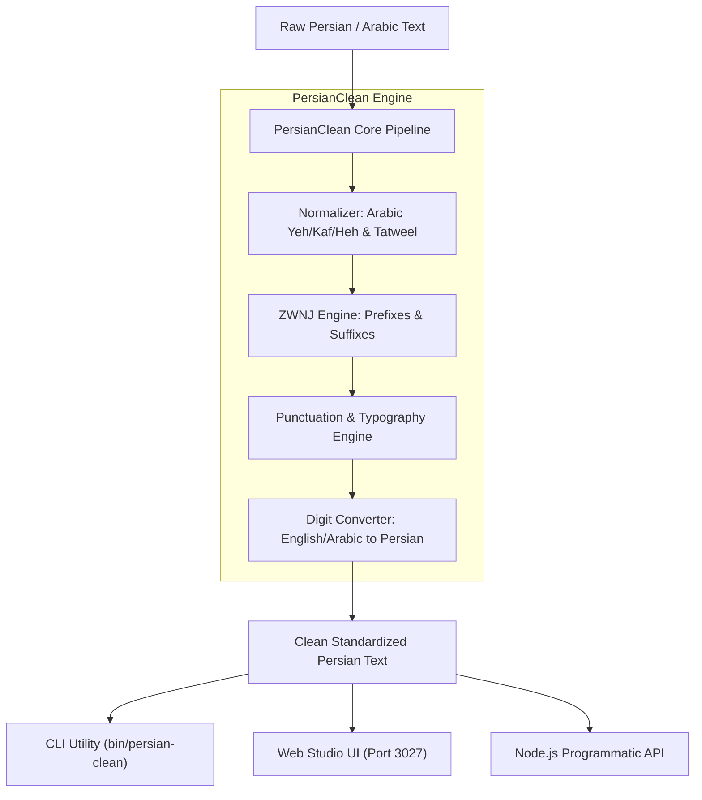

<div align="center">

# ✍️ PersianClean

**Zero-Dependency Persian Text Normalizer, Intelligent Half-Space (ZWNJ) Engine & Typography Studio**

[](https://nodejs.org/)
[](LICENSE)
[](package.json)
[](test/)
[](http://localhost:3027)

*A pure, high-performance Node.js typography engine engineered for modern Persian text processing, editorial workflows, automated publishing, and clean UI rendering.*

[Quick Start](#-quick-start) • [Features](#-key-features) • [Architecture](#-architecture) • [CLI Commands](#-cli-usage) • [Web Studio](#-web-studio) • [Node API](#-node-api)

---

</div>

## 🌟 Key Features

- **🛡️ 100% Zero Dependencies**: Built entirely with native Node.js core modules (`http`, `fs`, `path`, `url`, `node:test`).
- **🔤 Arabic Character Normalization**: Unifies Arabic Yeh (`ي`, `ى` → `ی`), Kaf (`ك` → `ک`), Teh Marbuta (`ة` → `ه`), and removes Tatweel/Kashida (`ـ`).
- **⚡ Intelligent ZWNJ Engine**: Context-aware Zero-Width Non-Joiner insertion for verbal prefixes (`می‌`, `نمی‌`), plural suffixes (`ها`, `های`), comparatives (`تر`, `ترین`), derivational suffixes (`مند`, `پذیر`, `شناس`), and possessives.
- **🔢 Bi-directional Digit Normalization**: Smooth conversion between Latin/Arabic digits (`0-9`, `٠-٩`) and standard Persian digits (`۰-۹`).
- **📐 Typographical Punctuation & Quotes**: Converts straight ASCII quotes to authentic Persian guillemets (`«...»`), normalizes Persian commas (`،`), semicolons (`؛`), and question marks (`؟`), and enforces strict typography spacing rules.
- **🖥️ Built-in Web Studio**: Interactive browser UI running locally on **Port 3027** with real-time preview, copy-to-clipboard, file export, and typographical metrics.
- **💻 Robust CLI**: Command-line utility supporting direct strings, piped UNIX streams, batch file processing, and in-place replacements.

---

## 🏗️ Architecture



---

## 🚀 Quick Start

### Global Installation / Local Execution

```bash
# Clone the repository
git clone https://github.com/mahdyarmonfared/persian-clean.git
cd persian-clean

# Run the test suite
npm test

# Launch the Web Studio
npm start
# Open http://localhost:3027 in your browser
```

---

## 💻 CLI Usage

The package includes an executable binary `persian-clean`:

```bash
# Clean a text string directly
npx persian-clean "كتاب هاي فارسي در سال 2026 توليد مي شوند."

# Piped UNIX input / Output redirection
cat unformatted.txt | npx persian-clean > cleaned.txt

# File processing
npx persian-clean input.txt -o output.txt

# In-place file replacement
npx persian-clean article.md --write

# Launch the Web Studio on custom port
npx persian-clean ui --port 3027
```

### CLI Flags & Options

| Option | Flag | Description | Default |
| :--- | :--- | :--- | :--- |
| `--output <file>` | `-o` | Target output file path | `stdout` |
| `--write` | `-w` | Edit input file in-place | `false` |
| `--no-zwnj` | | Skip automatic ZWNJ rule application | `false` |
| `--no-chars` | | Skip Arabic character normalization | `false` |
| `--no-digits` | | Do not convert digits to Persian | `false` |
| `--digits <fa\|en>` | | Specify target digits format (`fa` or `en`) | `fa` |
| `--port <num>` | `-p` | Set port for Web Studio server | `3027` |

---

## 🖥️ Web Studio

PersianClean includes an embedded Web Studio running on **Port 3027**:

```bash
npm start
# Server live at http://localhost:3027
```

### Studio Capabilities
- **Live Typographical Metrics**: Real-time counter of total words, characters, ZWNJs added, and Arabic glyphs normalized.
- **Granular Toggles**: Selectively enable or disable ZWNJ rules, character normalization, digit conversion, or quotation wrapping.
- **Sample Text**: One-click preview of common typography bugs and immediate normalization.
- **Safe Static Server**: Hardened Node.js HTTP server with path-traversal protection and zero external dependencies.

---

## 📦 Node API

You can import PersianClean directly into any Node.js application:

```javascript
const { cleanPersianText, getCleaningStats } = require('persian-clean');

const raw = 'كتاب هاي زيبا در سال 2026 توليد مي شود.';

// Standard clean
const cleaned = cleanPersianText(raw);
console.log(cleaned);
// Output: کتاب‌های زیبا در سال ۲۰۲۶ تولید می‌شود.

// Get typography audit metrics
const stats = getCleaningStats(raw, cleaned);
console.log(stats);
// {
//   wordCount: 8,
//   charCount: 42,
//   zwnjAdded: 2,
//   totalZwnj: 2,
//   arabicCharsFixed: 2,
//   isModified: true
// }
```

---

## 🧪 Testing

The test suite is built on Node's native test runner (`node:test` and `node:assert/strict`):

```bash
npm test
```

```text
▶ PersianClean - Normalizer Module (6 tests passed)
▶ PersianClean - Punctuation Module (4 tests passed)
▶ PersianClean - Web Studio Server & API (4 tests passed)
▶ PersianClean - ZWNJ Rule Engine (5 tests passed)

ℹ tests 19
ℹ suites 4
ℹ pass 19
ℹ fail 0
```

---

## 📄 License

MIT © [Mahdyar Monfared](https://github.com/mahdyarmonfared)
